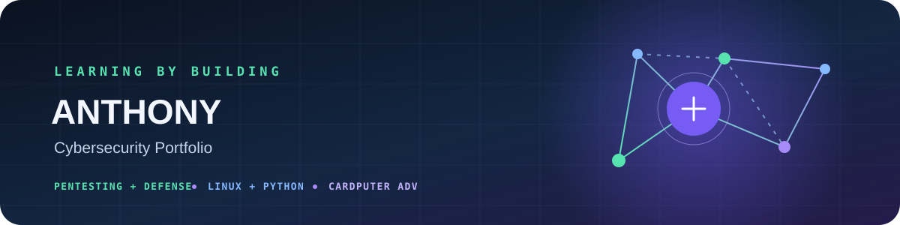

  

<h2 align="center">From hard hats to cybersecurity</h2>

  Building practical skills in penetration testing and defense — with a long-term goal of understanding both sides of security.

  
  

---

## 👋 About me

I’m Anthony. Before moving toward cybersecurity, I spent more than seven years in construction and worked my way from laborer to site manager. I bring that experience with planning, troubleshooting, safety, and follow-through into my technical work.

I’m rebuilding my skills through small hands-on projects and documenting what I learn. **Penetration testing interests me most right now.** I’m practicing in authorized labs, while also learning how defenders detect and respond to security issues. My long-term goal is to grow across both offensive and defensive security.

## 🧭 Current focus

| 🧪 Pentesting | 🐍 Python | 🐧 Linux | 💻 Cardputer ADV |
|:---:|:---:|:---:|:---:|
| Learning methods in authorized labs | Building and testing small tools | Terminal and system fundamentals | Learning embedded programming |

## 🧪 Featured projects

| Project | What I’m learning |
| --- | --- |
| [Domain Posture Check](https://github.com/elcasodepaz/purple-lab-home/tree/main/domain-posture-check) | Python, DNS, HTTPS, TLS, security headers, and offline unit tests |
| [Purple Lab Home](https://github.com/elcasodepaz/purple-lab-home) | Controlled lab practice, documenting observations, and defensive takeaways |
| [Ojo-cibernético](https://github.com/elcasodepaz/Ojo-cibernetico) | Spanish-language OSINT project I translated and studied; improving its documentation |

## 🎓 Training

  
  

## 🧰 Tools I’m practicing

Linux · Python · Git and GitHub · networking fundamentals · security logs · cloud security concepts

## ✅ How I work

I test only systems I own or have permission to assess. For each project, I aim to explain the goal, setup, steps, results, limitations, and defensive takeaways. My goal is to understand both the testing and defense sides. Work in progress is labeled clearly.

  <a href="https://github.com/elcasodepaz">GitHub: @elcasodepaz</a> ·
  <a href="https://elcasodepaz.github.io/">Portfolio</a> ·
  English / Español

